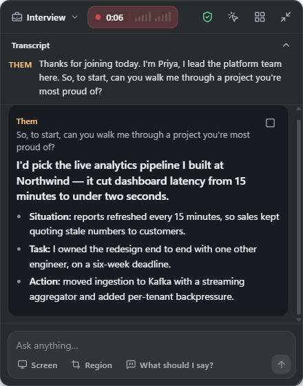
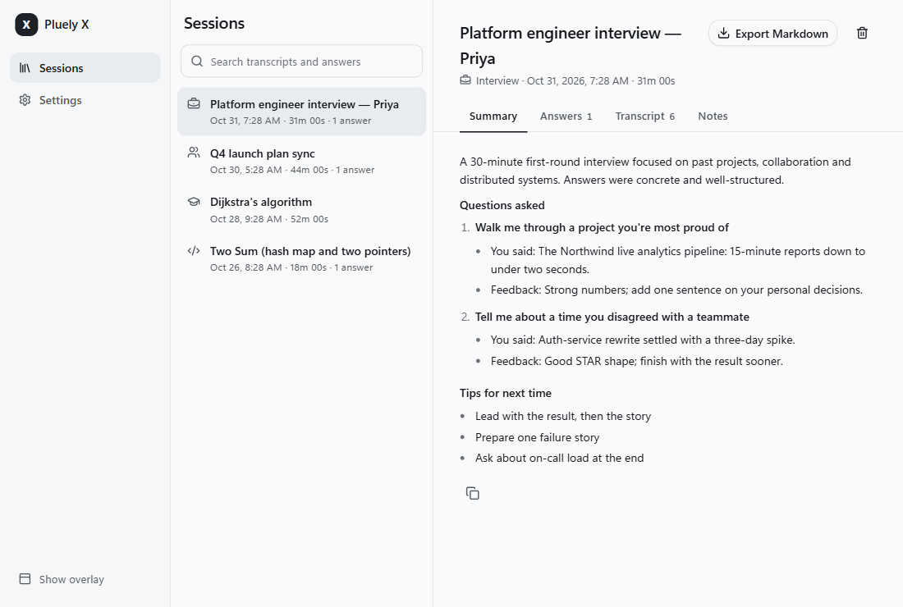

# Pluely X

**A real-time AI copilot for meetings, interviews, coding and lectures on Windows.** It sits in a small overlay, listens to both sides of a call, notices when you're asked something, and shows a short answer you can say out loud. It can also solve whatever is on your screen.

Pluely X is a ground-up rebuild of [Pluely](https://github.com/iamsrikanthnani/pluely) by Srikanth Nani. It keeps Pluely's native core (Tauri, system-audio capture, screenshots, an overlay hidden from screen share) and replaces the rest. See [Credits and license](#credits-and-license).

<p>
  
  
</p>

## What it does

- **One-minute setup.** Paste a Claude key and, optionally, a Deepgram key. Both are tested live and stored in Windows Credential Manager.
- **Live two-sided transcript.** Your mic ("You") and the call audio ("Them") are captured separately and transcribed as people speak, using Deepgram's Nova-3 streaming.
- **Answers when you're asked.** When the other person finishes a question, an answer starts streaming in about a second. Small talk is ignored. *What should I say?* (<kbd>Ctrl</kbd>+<kbd>Alt</kbd>+<kbd>Enter</kbd>) works any time.
- **Answers you can say out loud.** Each answer opens with one or two first-person sentences you can read word for word, followed by a few short talking points. Private tips ("swap in your own numbers") are kept apart from the script.
- **Your screen in one key.** Ask about the whole screen or a region you drag out. Coding mode solves the problem shown, with approach, complexity, edge cases and runnable code.
- **Modes:** Meeting, Interview, Coding, Lecture and Ask. Each tunes how answers are written and what notes are kept.
- **Briefs.** Attach your résumé, the job description, slides or an agenda (several PDF, DOCX, TXT or MD files) to ground answers in your real experience. Briefs are sent as a cached prompt prefix, so long ones stay fast and cheap.
- **Notes and summaries.** Rolling notes during meetings and lectures, then a summary when the session ends: decisions, action items and a follow-up email; interview feedback; or lecture study notes and practice questions.
- **Sessions library.** Full-text search across every transcript and answer, and Markdown export.
- **Stays out of the way.** The overlay is hidden from screen sharing and recording, never steals focus from your call app, can be made click-through, and stays out of Alt+Tab.

## Requirements

- Windows 10 or 11 (x64)
- An [Anthropic API key](https://console.anthropic.com/). Answers use Claude Opus 5.5 by default; you can change the model and effort in Settings.
- A [Deepgram API key](https://console.deepgram.com/) to transcribe live calls. It's optional if you only type questions or ask about your screen.

## Build and run

You need Node.js 20+, Rust (stable, MSVC toolchain) and Visual Studio Build Tools with the "Desktop development with C++" workload.

```powershell
npm ci
npx tauri dev                    # run in development
npx tauri build --bundles nsis   # build the Windows installer
```

The installer is written to `src-tauri/target/release/bundle/nsis/`.

Tests:

```powershell
npx vitest run                          # frontend
cd src-tauri; cargo test --lib          # native (no hardware or keys needed)
cargo test --lib hw_ -- --ignored       # optional: real audio devices
```

## Default shortcuts

| Action | Keys |
|---|---|
| Show / hide the overlay | <kbd>Ctrl</kbd>+<kbd>\\</kbd> |
| Start / stop listening | <kbd>Ctrl</kbd>+<kbd>Alt</kbd>+<kbd>L</kbd> |
| What should I say? | <kbd>Ctrl</kbd>+<kbd>Alt</kbd>+<kbd>Enter</kbd> |
| Ask about the screen | <kbd>Ctrl</kbd>+<kbd>Alt</kbd>+<kbd>S</kbd> |
| Ask about a region | <kbd>Ctrl</kbd>+<kbd>Alt</kbd>+<kbd>R</kbd> |
| Type a question | <kbd>Ctrl</kbd>+<kbd>Alt</kbd>+<kbd>Q</kbd> |
| Click-through on / off | <kbd>Ctrl</kbd>+<kbd>Alt</kbd>+<kbd>C</kbd> |
| Sessions and settings | <kbd>Ctrl</kbd>+<kbd>Alt</kbd>+<kbd>D</kbd> |

Every shortcut can be changed in Settings, and conflicts with other apps are reported.

## Privacy

- API keys live in Windows Credential Manager and never reach the web view. All network calls are made by the Rust side.
- Sessions, transcripts, briefs and settings are stored locally on your PC (SQLite).
- Call audio is sent to Deepgram for transcription. Transcripts, screenshots you choose to send, and briefs go to Anthropic to generate answers. Nothing else is sent anywhere, and there is no telemetry.

## Use it responsibly

Recording or transcribing other people can require their consent, depending on where you are. Tell people when you're using it. Don't use it where AI assistance isn't allowed, such as exams, proctored tests or interviews that forbid it.

## How it's built

- **Native (Rust, Tauri 2):**
  - WASAPI mic and loopback capture.
  - Deepgram streaming over WebSockets.
  - A streaming proxy for the Anthropic Messages API.
  - DPI-correct screenshots.
  - A non-activating, capture-excluded overlay, plus tray and global shortcuts.
- **Frontend:** React, TypeScript, Tailwind and Zustand.

Design notes:

- [docs/CONTRACT.md](docs/CONTRACT.md): every native command, event and channel.
- [docs/NATIVE_DESIGN.md](docs/NATIVE_DESIGN.md): the audio pipeline and windowing on Windows.
- [docs/FRONTEND.md](docs/FRONTEND.md): frontend structure, stores and the browser mock.
- [docs/PLAN.md](docs/PLAN.md): the original plan.

## Credits and license

Pluely X is a modified version of **[Pluely](https://github.com/iamsrikanthnani/pluely)** by Srikanth Nani, released under the GNU General Public License v3.0. The upstream history is kept in this repository.

Modifications by Muhammad Sabih Ul Hussnain, 2026:
- The frontend was rewritten.
- The audio capture and speech-to-text pipeline was replaced with streaming transcription.
- Answers became question-aware and speakable.
- Modes, briefs, notes, summaries and the sessions library were added.
- The upstream server, licensing and telemetry code was removed.

Pluely X is licensed under the **GNU General Public License v3.0**; see [LICENSE](LICENSE). It is not affiliated with or endorsed by the Pluely project, Cluely, Anthropic or Deepgram.
